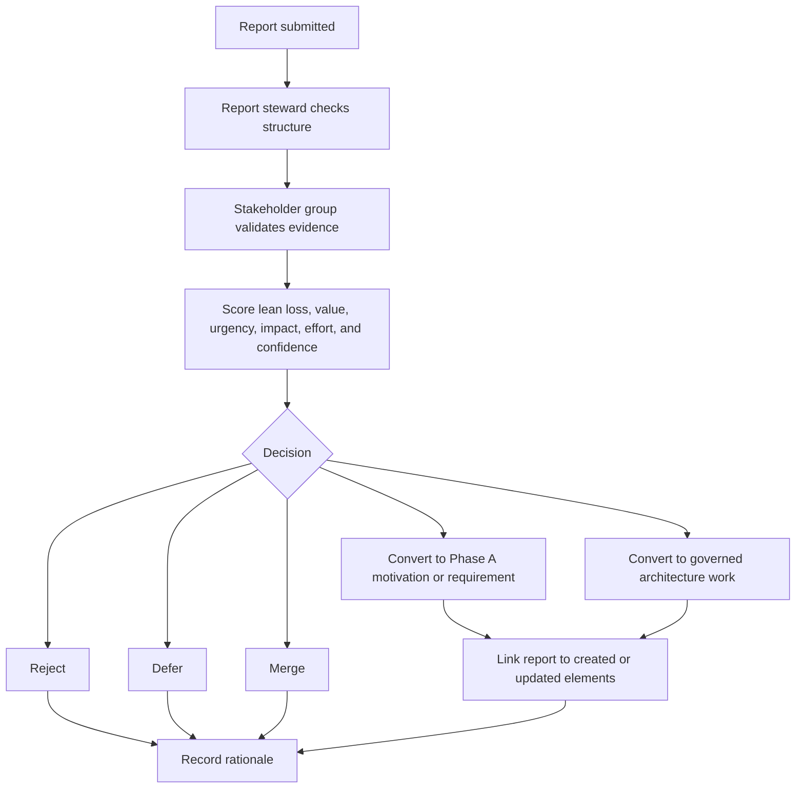

# Preliminary 0006: Validate and Score Reports with Stakeholder Roles

- Record: Reusable policy
- Tags: preliminary, stakeholders, reporting, validation, scoring, governance, learning-loop

## Context

[Preliminary 0002](0002-align-architecture-work-with-lean-software-product-development.md)
requires accountable stakeholder roles before reports become governed
architecture input. Reports should not become architecture input only because
they were written down. The repository needs a repeatable way for stakeholders
to validate reports, score their significance, and decide whether they should be
rejected, deferred, merged, or converted into architecture work.

Validation and scoring should bring together the people who understand market
value, user or tenant evidence, delivery impact, technology quality, governance, and
architecture motivation.

Organization units and synchronization boards are defined separately in
[Preliminary 0012](0012-define-organization-units-for-report-handling.md).
This record defines per-report validation responsibilities, not the organization
chart.

## Decision

Architecture-relevant reports will be validated and scored by a stakeholder
group before they are converted into Phase A motivation elements, requirements,
or governed work.

The validation group does not need to be large for every report, but each report
must have named accountable roles for origin, stewardship, architecture judgment,
product value, delivery impact, engineering impact, governance quality, and
board sponsorship when the report is synchronized.

One person or organization unit may fulfill several validation roles for a
simple report, but the report must still show which responsibilities were
covered.

## Stakeholder Roles

| Role | Responsibility in validation and scoring |
| --- | --- |
| `ROLE-001 Report Originator` | Provides the original statement, source context, evidence, and expected value or pain. |
| `ROLE-002 Report Steward` | Structures the report, preserves the original statement, checks required metadata, and prepares it for review. |
| `ROLE-003 Architecture Owner` | Determines whether the report changes drivers, assessments, goals, outcomes, principles, constraints, requirements, or architecture decisions. |
| `ROLE-004 Product Owner` | Scores market value, customer or tenant relevance, product direction fit, and opportunity timing. |
| `ROLE-005 Delivery Owner` | Scores delivery effort, rollout impact, implementation dependency, operational burden, and update impact. |
| `ROLE-006 Engineering Owner` | Scores technical feasibility, quality impact, testability, maintainability, security exposure, and technology risk. |
| `ROLE-007 Governance Reviewer` | Checks traceability, decision quality, required approvals, and whether the report can be audited later. |
| `ROLE-008 Board Sponsor` | Owns board-level synchronization, prioritization follow-up, and clarification with the reporter for reports routed under [Preliminary 0011](0011-define-phase-h-report-intake-and-board-routing.md). |

## Validation Flow

## Scoring Dimensions

Scores should use a simple scale from `1` to `5`, where `1` is low and `5` is
high.

| Dimension | Scored question |
| --- | --- |
| Lean loss severity | How much waste, risk exposure, missed learning, or market loss occurs if the report is ignored? |
| Market impact | How strongly does the report affect sales, customer or tenant commercial interest, high-level scope, due diligence, pricing, product positioning, product packaging, market opportunity, or product credibility? |
| Operational impact | How strongly does the report affect delivery comfort, ownership, commitment reliability, requirements clarification, planning, coordination, rollout, QA evidence, or operational burden? |
| Technology impact | How strongly does the report affect architecture, engineering quality, technical feasibility, implementation impact, automation, platform behavior, maintainability, security exposure, DevOps, or technology risk? |
| Evidence strength | How strong and repeatable is the evidence behind the report? |
| Stakeholder breadth | How many relevant stakeholder groups are affected? |
| Urgency | How quickly does the report need a decision before loss increases? |
| Architecture impact | How strongly does the report affect motivation, requirements, principles, constraints, or architecture decisions? |
| Product value | How strongly does the report support customer or tenant adoption, market fit, revenue, product credibility, or strategic positioning? |
| Delivery and engineering effort | How much delivery, migration, engineering, testing, or governance effort is likely required? |
| Confidence | How confident is the group that the classification, loss type, and ADM placement are correct? |

## Required Validation Outcome

Each validated report must record:

- Participating roles.
- Responsible handling organization unit.
- Validation date.
- Synchronization board and sponsor, when board review is required.
- Report classification: idea, risk, or problem.
- Market, operational, and technology impact scores.
- Lean loss types and severity score.
- ADM placement.
- Scoring summary.
- Decision: reject, defer, merge, convert to Phase A, or convert to governed
  architecture work.
- Rationale and trace links.

## Consequences

- Reports are evaluated by the right perspectives before they shape architecture
  decisions.
- Scoring makes prioritization explicit while still preserving qualitative
  rationale.
- The learning loop becomes governable because every report has a validation
  outcome and traceable next step.
