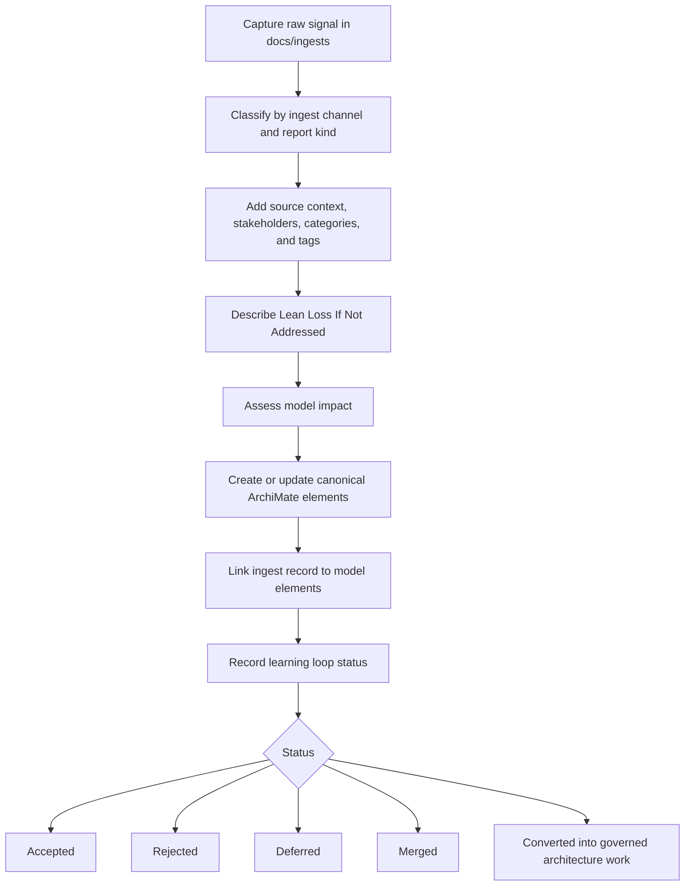

# Preliminary 0010: Run Ingest to Model as a Lean Learning Loop

- Record: Reusable policy
- Tags: preliminary, phase-h, phase-a, architecture-process, learning-loop, lean, reporting, governance

## Context

[Preliminary 0002](0002-align-architecture-work-with-lean-software-product-development.md)
requires an explicit learning loop from product and technology feedback into
architecture motivation, requirements, decisions, and governance. The current
architecture repository is being used to collect product feedback, ideas, risks,
and architecture implications before the target architecture is fully described.

To keep the process useful, every architecture-relevant report must feed a
learning loop. The repository should preserve the original signal as an ingest,
make the expected loss of ignoring the signal explicit, and then convert the
signal into canonical ArchiMate model elements when the evidence is strong
enough.

## Decision

We will run the current architecture process as a lean learning loop from
knowledge ingests into canonical ArchiMate model elements. TOGAF 10 ADM supplies
the controlling architecture process frame, while SAFe/lean learning-loop
practices supply the signal intake, validation, prioritization, and conversion
discipline.

Every report must include a section named `Lean Loss If Not Addressed`. This
section describes the kind of waste, delay, risk exposure, missed learning, or
market loss that the organization is likely to experience if the report is not
covered by an architecture decision, motivation element, requirement, backlog
item, or explicit rejection. Lean loss types and report classification are
defined in [Preliminary 0005](0005-classify-reports-by-lean-loss-and-adm-placement.md).

Reports must be captured in the correct `docs/ingests/<channel>/` area first,
then reviewed for model implications. Stakeholder validation and scoring are defined in
[Preliminary 0006](0006-validate-and-score-reports-with-stakeholder-roles.md).
Thesis-first intake, agent-assisted enrichment, Jira evidence links, and board
routing are defined in
[Preliminary 0011](0011-define-phase-h-report-intake-and-board-routing.md).
Organization-unit responsibility for report handling is defined in
[Preliminary 0012](0012-define-organization-units-for-report-handling.md).

## Learning Loop Process Flow

1. Capture the raw signal in `docs/ingests/<channel>/` without losing the original statement.
2. Classify the record by ingest channel and report kind.
3. Identify source context, stakeholders, categories, tags, and related reports.
4. Describe `Lean Loss If Not Addressed`.
5. Assess whether the report creates or changes canonical model elements in
   `docs/model/`.
6. Link the ingest record to any created or updated model elements.
7. Close the loop by recording whether the report is accepted, rejected,
   deferred, merged into another report, or converted into governed architecture
   work.

## Lean Loss and Role References

- Use the lean loss taxonomy from
  [Preliminary 0005](0005-classify-reports-by-lean-loss-and-adm-placement.md).
- Use the stakeholder role model from
  [Preliminary 0006](0006-validate-and-score-reports-with-stakeholder-roles.md).
- Use the thesis-first intake and board routing rules from
  [Preliminary 0011](0011-define-phase-h-report-intake-and-board-routing.md).
- This preliminary record defines how those classifications and roles operate together inside
  the ingest-to-model learning loop.

## Reporting Table

| Report kind | Use when | Location | Identifier pattern | Required lean loss focus | Model output |
| --- | --- | --- | --- | --- | --- |
| Idea | The report proposes a possible product, architecture, process, automation, market, or operating model improvement that still needs validation before it becomes a defined change. | `docs/ingests/ideas/` | `idea-000-short-name.md` | Missed learning, market opportunity loss, waiting, underused knowledge, overprocessing, or rework avoided by exploring the proposed idea. | Candidate model change, motivation element, requirement, product vision input, or formal architecture change request. |
| Risk | The report describes uncertainty that may harm quality, delivery, compliance, adoption, cost, security, maintainability, or market fit. | `docs/ingests/discussions/`, `docs/ingests/research/`, `docs/ingests/regulations/`, or another source channel | `risk-000-short-name.md` | Expected exposure if the risk is ignored, including defect and quality loss, governance loss, market opportunity loss, update cost, or delivery rework. | Candidate assessment, constraint, principle, outcome, requirement, or mitigation decision. |
| Problem | The report describes an observed pain, defect, recurring failure, user or tenant issue, process bottleneck, or current-state limitation. | `docs/ingests/helpdesk/`, `docs/ingests/telemetry/`, `docs/ingests/logs/`, or another source channel | `problem-000-short-name.md` | Current waste already being experienced, especially waiting, rework, handoff loss, defect and quality loss, overprocessing, or backlog aging. | Candidate assessment, driver, outcome, requirement, or formal architecture change request. |

## Required Report Structure

Every ingest record should contain, at minimum:

- Status.
- Source context.
- Reporter, report originator, or stakeholder group.
- Raw thesis.
- Concern type: product, operational, technology, or a combination.
- Responsible handling organization unit.
- Categories and tags.
- Original statement.
- Linked evidence, including Jira incidents or issue links when known.
- Report classification: idea, risk, or problem.
- `Lean Loss If Not Addressed`, using one or more lean loss types.
- Board route and sponsor after synchronization.
- TOGAF relevance and expected model-layer impact.
- Related reports, SWOT observations, or motivation elements.
- Candidate architecture implications.
- Learning loop status: open, accepted, rejected, deferred, merged, or converted.

## Consequences

- Reports become comparable because each one names the loss of not learning from
  it.
- The repository can support lean prioritization without treating all feedback as
  equally urgent.
- Canonical model elements remain traceable to field evidence and current
  process pain through ingest records.
- Architecture governance can see which reports are still open and which have
  been converted into explicit decisions, requirements, or rejected options.
