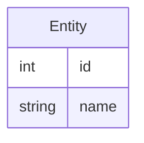

# Metamodel for C Data

Phase C Data Architecture describes information structures handled by applications, APIs, persistence, search, integration, and exchange contracts. Data element articles live in `C - Information Systems Architecture/data/`.

Phase C has two TOGAF subphases. Application Architecture is defined separately in [Metamodel for C Application](Metamodel%20for%20C%20Application.md).

## Canonical Element Types

| Group | Element types | Use in Phase C data architecture |
| --- | --- | --- |
| Passive structure | Data Object | Use for information structures handled by applications, APIs, persistence, search, integration, and exchange contracts. |

## Article Guidance

- Keep one markdown file per ArchiMate element.
- Use the element name as the level-1 heading.
- Use a level-1 heading with `«Data Object»` as the stereotype.
- Put data objects under `C - Information Systems Architecture/data/`.
- Link data objects to business objects, application services, APIs, storage technology, and migration plateaus when relevant.
- Describe the data object as a model, not only as an implementation artifact. The article must identify storage placement, schema shape, attributes, relations, and reverse demand.

## Data Object Article Structure

Use this article structure for each Phase C data object:

~~~text
# Element Name «Data Object»

## Description

Short description of the information structure and its architectural role.

## Model

### Storage

| Storage | Name | Description |
| --- | --- | --- |
| Product Database | <database object or schema area> | <how the data object is persisted or read> |

### ER Diagram Schema



### Attributes

| Name | Type | Description |
| --- | --- | --- |
| id | int | Stable identifier. |
| name | string(128) | Display name. |

## Relations

- Relationship stereotype: linked element.

## Required by

- Linked element that depends on, requires, or consumes this element.
~~~

If a data object has no relational structure, keep the `ER Diagram Schema` heading and state why an ER diagram is not applicable.

## Validation Rules

| Rule | Applies to | Validation |
| --- | --- | --- |
| Cd1 | Data Object | Each Phase C data element article must use `«Data Object»` as the stereotype. |
| Cd2 | Data Object article structure | Each Data Object article must include Description, Model, Storage, ER Diagram Schema, Attributes, Relations, and Required by sections, or explicitly state why a section is not applicable. |
| Cd3 | Data Object diagrams | ER diagrams may use ER-specific notation, but any referenced architecture element outside the ER schema must exist as a Markdown model article. |

## Storage Vocabulary

Use one or more of these storage values in the `Storage` table:

| Storage | Meaning |
| --- | --- |
| Product Database | Data persisted in, read from, or derived from product database tables, views, procedures, functions, triggers, or generated metadata objects. |
| Message Bus | Data exchanged through asynchronous messaging, events, queues, topics, or streams. |
| Integration Contract | Data exposed or consumed through API, file, schema, or partner-facing contract boundaries. |
| Git | Data represented as source-controlled files or repository content. |

The `Name` column identifies the concrete database schema/object, queue/topic, contract/schema, file path shape, or repository area. Use `Description` to explain whether the data object is authoritative, projected, exported, imported, derived, or cached.

## Attribute Type Notation

Attribute tables use three columns: `Name`, `Type`, and `Description`.

`Name` is the attribute name as it appears in the contract or storage model. Preserve existing casing when documenting an existing source.

`Type` uses a C#-style base type with repository suffixes:

| Form | Meaning | Example |
| --- | --- | --- |
| `<type>` | Required scalar value. | `int` |
| `string(<length>)` | String with a maximum or declared length. | `string(128)` |
| `decimal(<size>,<precision>)` | Decimal with declared size and precision. | `decimal(18,2)` |
| `<type>[]` | Variable-length array. | `Guid[]` |
| `<type>[<fixedlength>]` | Fixed-length array. | `byte[16]` |
| `<type>[key]` | Key-value dictionary where the documented type is the value type. | `string(256)[key]` |
| `<type>?` | Optional value. The `?` is always the final suffix. | `decimal(18,2)?` |

Use C# base type names for primitives, including `bool`, `byte`, `short`, `int`, `long`, `decimal`, `float`, `double`, `string`, `DateTime`, `DateOnly`, `TimeOnly`, and `Guid`. Use a linked data object or domain type name when the attribute value is a nested model instead of a primitive.

Suffixes are ordered as:

```text
<base-type><string-or-decimal-size><array-or-dictionary-suffix><optional-suffix>
```

Examples:

| Type | Meaning |
| --- | --- |
| `string(64)?` | Optional string with maximum length 64. |
| `decimal(19,4)[]` | Required variable-length array of decimals holding 4 digits after comma. |
| `Guid[2]?` | Optional fixed-length array containing two GUID values. |
| `string(128)[key]?` | Optional dictionary whose values are strings with maximum length 128. |

`Description` is the final human-readable explanation of the attribute. It should describe semantics, source mapping, constraints, units, allowed values, identity behavior, or lifecycle rules that are not already expressed by the name and type.

## Filename Prefixes

Use the repository filename pattern from [Metamodel](Metamodel.md):
`<type-in-lowercase>-<NNNN>-<slug>.md`.

| Element type | Prefix examples |
| --- | --- |
| Data Object | `data-object-` |
