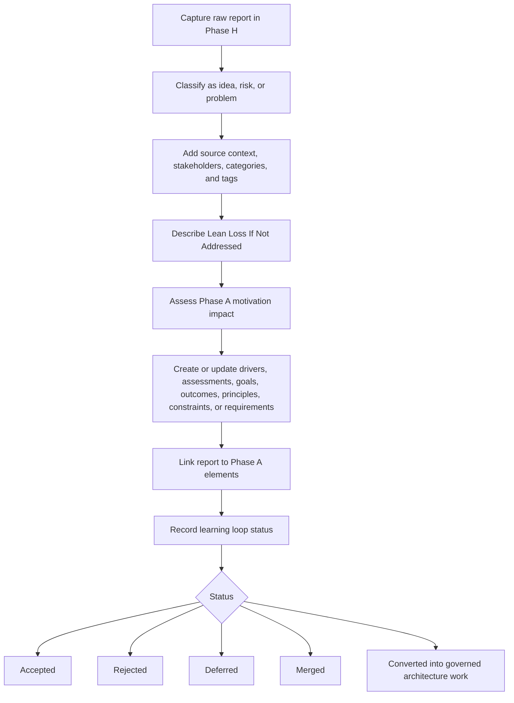

# Metamodel for H

Phase H describes architecture change management. Canonical ArchiMate element articles live directly in `H - Architecture Change Management/`; source reports may use working areas for feedback, ideas, risks, and problems. Change backlogs, impact views, and roadmap views are managed through catalogs and viewpoints, not element-family subfolders.

## Canonical Element Types

| Group | Element types | Use in Phase H |
| --- | --- | --- |
| Change motivation | Driver, Assessment, Goal, Outcome, Requirement, Constraint | Use for new pressures, impact assessments, desired changes, target results, change requirements, and change limits. |
| Change strategy | Capability, Course of Action | Use for capabilities affected by change and the selected response to change. |
| Change execution and state | Work Package, Plateau, Gap | Use for proposed change work, affected architecture states, and differences that trigger or result from change. |

## Article Guidance

- Keep one markdown file per ArchiMate element.
- Use the element name as the level-1 heading.
- Use a level-1 heading with one of the canonical Phase H element types as the stereotype.
- Link change drivers and assessments to the affected Phase A through Phase G elements.
- Link approved change requirements to Requirements Management when they need cross-phase tracking.

## Phase H Learning Loop

Phase H is the entry point for architecture-relevant feedback before it becomes governed motivation, requirements, decisions, or implementation work. Every architecture-relevant report must preserve the original signal, make the expected loss of ignoring the signal explicit, and then be assessed for Phase A motivation and requirements impact when the evidence is strong enough.

Every report must include a section named `Lean Loss If Not Addressed`. This section describes the kind of waste, delay, risk exposure, missed learning, or market loss that the organization is likely to experience if the report is not covered by an architecture decision, motivation element, requirement, backlog item, or explicit rejection.

Reports must be captured in the correct Phase H working area first, then reviewed for Phase A implications. Stakeholder validation, scoring, report handling organization, and board identifiers are defined in [TOGAF Process](TOGAF%20Process.md).



1. Capture the raw report in Phase H without losing the original statement.
2. Classify the report as an idea, risk, or problem.
3. Identify source context, stakeholders, categories, tags, and related reports.
4. Describe `Lean Loss If Not Addressed`.
5. Assess whether the report creates or changes Phase A drivers, assessments, goals, outcomes, principles, constraints, or requirements.
6. Link the report to any created or updated Phase A motivation elements.
7. Close the loop by recording whether the report is accepted, rejected, deferred, merged into another report, or converted into governed architecture work.

## Report Classification

Use the lean loss taxonomy, stakeholder role model, and organization model from [TOGAF Process](TOGAF%20Process.md).

| Report kind | Use when | Location | Identifier pattern | Required lean loss focus | Phase A output |
| --- | --- | --- | --- | --- | --- |
| Idea | The report proposes a possible product, architecture, process, automation, market, or operating model improvement that still needs validation before it becomes a defined change. | `docs/togaf/H - Architecture Change Management/ideas/` | `idea-000-short-name.md` | Missed learning, market opportunity loss, waiting, underused knowledge, overprocessing, or rework avoided by exploring the proposed idea. | Candidate goal, outcome, principle, requirement, product vision input, or formal architecture change request. |
| Risk | The report describes uncertainty that may harm quality, delivery, compliance, adoption, cost, security, maintainability, or market fit. | `docs/togaf/H - Architecture Change Management/feedback/` | `risk-000-short-name.md` | Expected exposure if the risk is ignored, including defect and quality loss, governance loss, market opportunity loss, update cost, or delivery rework. | Candidate assessment, constraint, principle, outcome, requirement, or mitigation decision. |
| Problem | The report describes an observed pain, defect, recurring failure, user or tenant issue, process bottleneck, or current-state limitation. | `docs/togaf/H - Architecture Change Management/feedback/` | `PROBLEM-000-short-name.md` | Current waste already being experienced, especially waiting, rework, handoff loss, defect and quality loss, overprocessing, or backlog aging. | Candidate assessment, driver, outcome, requirement, or formal architecture change request. |

## Intake and Routing

Phase H reporting uses a thesis-first intake process. Anyone may submit a report. An assisting agent may create or structure the report on behalf of the reporter, but the report must preserve the reporter's raw thesis before enrichment, interpretation, scoring, or board discussion.

Submitting a report starts with a conversation. The reporter explains the concern in ordinary market, operational, or technology language. Based on that discussion, the assisting agent or report steward drafts the report, preserves the raw thesis, classifies the report on the two report dimensions, and proposes the best-matching board route.

Every Phase H report must be routed to a synchronization board for discussion, clarification, scoring, and prioritization. Market reports go to the Market Board. Operational reports go to the Delivery Board. Technology reports go to the Architecture Board. The reporter must be available during synchronization to present the report thesis to the sponsor or board and clarify intent, evidence, and expected loss.

Each report must be classified on two dimensions:

- Concern dimension: market, operational, or technology.
- Report-class dimension: idea, risk, or problem.

The concern dimension determines the primary synchronization board. The report-class dimension determines whether the thesis proposes an idea, describes uncertainty, or records an already observed pain. Reports with mixed concern types must be routed by dominant concern. Secondary boards should be listed when their input is required for scoring, clarification, or evidence.

| Concern type | Use when the thesis is mainly about | Examples |
| --- | --- | --- |
| Market | Market value, marketability, packaging, commercial experience, high-level scope, sales fit, due diligence, pricing, feature granularity, or positioning. | Poor user experience, high perceived cost, due diligence concern, feature granularity that prevents partial adoption. |
| Operational | Delivery comfort, ownership, commitment reliability, process burden, supportability, coordination, unexpected work, or organizational operating pain. | Orphan work, uncomfortable delivery responsibility, random events disrupting commitments. |
| Technology | Architecture, engineering quality, automation, maintainability, impact control, defects, unexpected behavior, manual control, or platform fit. | Too many bugs, too much change impact, automation that still needs manual fine-tuning. |

| Report class | Use when the thesis mainly says | Typical result |
| --- | --- | --- |
| Idea | We might change, add, simplify, automate, package, govern, or improve something. | Board discussion confirms whether the proposed idea should become Phase A motivation, requirement input, a formal architecture change request, or governed architecture work. |
| Risk | Something uncertain may harm sales, delivery, quality, compliance, maintainability, cost, governance, or technology fit. | Board discussion confirms exposure, severity, mitigation priority, and whether the risk becomes an assessment, constraint, requirement, or decision input. |
| Problem | Something painful or wasteful is already happening. | Board discussion confirms the thesis, current impact, priority, and whether the problem becomes a driver, assessment, outcome, requirement, or formal architecture change request. |

### Participation Flow

1. Reporter calls or invokes an assisting agent and explains the concern.
2. Agent asks clarifying questions until the raw thesis, source context, and expected loss are clear enough to draft a report.
3. Agent drafts the Phase H report, preserving the raw thesis before analysis.
4. Agent classifies the report on both dimensions: concern type and report class.
5. Agent proposes the responsible handling organization unit and best-matching board route.
6. The board sponsor or steward adds the report to the relevant board discussion plan.
7. The reporter is invited to the board discussion to present the thesis and clarify evidence, intent, impact, and expected loss.
8. The board discusses the report, agrees or challenges the thesis, scores it, and prioritizes it.
9. The board records the synchronization outcome and any trace links to Phase A motivation, requirements, decisions, Jira evidence, or related reports.

### Enrichment Rules

The report steward or assisting agent may enrich the report after the raw thesis is preserved.

Enrichment must:

- Restate the thesis in clearer architecture language without replacing the raw thesis.
- Add a short description of the market, operational, or technology concern.
- Classify the report as an idea, risk, or problem using the report-class definitions.
- Identify lean loss types and initial severity.
- Add candidate Phase A motivation or requirements implications when visible.
- Keep uncertainty explicit when evidence is incomplete or unvalidated.

Enrichment must not silently convert a reporter's thesis into an architecture decision, requirement, or delivery commitment. Conversion requires board synchronization and the validation flow defined in [TOGAF Process](TOGAF%20Process.md).

### Board Routing

| Board | Identifier | Receives | Core participants | Output |
| --- | --- | --- | --- | --- |
| Market Board | `BOARD-001` | Market reports whose dominant impact is sales, commercial interest, high-level scope, due diligence, pricing, positioning, packaging, or market opportunity. | Market Office representatives, with Delivery Office input when shaping, clarification, planning, or delivery feasibility is material. | Synchronized market thesis, scoring, priority, sponsor, and Phase A conversion recommendation. |
| Delivery Board | `BOARD-002` | Operational reports whose dominant impact is delivery comfort, ownership, commitment reliability, requirements clarification, QA evidence, rollout, or delivery coordination. | Delivery Office representatives, with Market Office or Technology Office input when market or technology impact is material. | Synchronized operational thesis, scoring, priority, sponsor, and follow-up route. |
| Architecture Board | `BOARD-003` | Technology reports whose dominant impact is architecture, engineering quality, implementation structure, customization, DevOps, platform, automation, maintainability, security exposure, or technology risk. | Technology Office representatives, with Delivery Office input when requirements, QA, delivery, release, rollout, or customization impact is material. | Synchronized technical assessment, scoring, priority, sponsor, and architecture follow-up route. |

Reports with mixed concern types may be routed to more than one board, but one board must be named as the primary synchronization owner.

### Synchronization Outcome

After board synchronization, each report must record:

- Responsible handling organization unit.
- Synchronization board.
- Sponsor.
- Context representatives involved or consulted.
- Participants or represented roles.
- Discussion plan reference or date.
- Reporter clarification notes.
- Thesis agreement: agreed, challenged, refined, deferred, or rejected.
- Confirmed classification: idea, risk, or problem.
- Confirmed market, operational, and technology impact scores.
- Confirmed lean loss types and severity.
- Scoring and prioritization summary.
- Priority.
- Decision: reject, defer, merge, convert to Phase A, or convert to governed architecture work.
- Trace links to related reports, Jira incidents, Phase A elements, requirements, or decisions when known.

Every Phase H report should contain, at minimum:

- Status.
- Source context.
- Reporter, report originator, or stakeholder group.
- Raw thesis.
- Concern type: product, operational, technology, or a combination.
- Responsible handling organization unit.
- Categories and tags.
- Original statement.
- Linked evidence, including Jira incidents or issue links when known.
- Report classification: idea, risk, or problem.
- `Lean Loss If Not Addressed`, using one or more lean loss types.
- Board route and sponsor after synchronization.
- TOGAF relevance, especially Phase H to Phase A flow.
- Related reports, SWOT observations, or motivation elements.
- Candidate architecture implications.
- Learning loop status: open, accepted, rejected, deferred, merged, or converted.

## Report Template

Use this structure for Phase H source reports:

```markdown
# <Report Title>

- Status: Draft
- Reporter:
- Source context:
- Concern type: Market / Operational / Technology
- Report classification: Idea / Risk / Problem
- Market impact score:
- Operational impact score:
- Technology impact score:
- Responsible handling organization unit: ORG-001 / ORG-002 / ORG-003
- Context representatives: REP-001 Market Representative / REP-002 Delivery Representative / REP-003 Technology Representative
- Proposed board route: BOARD-001 / BOARD-002 / BOARD-003
- Board discussion plan status: Not planned / Planned / Discussed
- Tags: phase-h, architecture-change-management

## Raw Thesis

Capture the reporter's original thesis as directly as possible before analysis, cleanup, scoring, or interpretation.

## Agent Discussion Notes

- Clarifying questions:
- Reporter answers:
- Open assumptions:

## Linked Evidence

- Jira:
- Related incidents, issues, users, deals, delivery events, or examples:
- Evidence validation status: Unvalidated / Partially validated / Validated

## Agent-Enriched Description

Restate the thesis in clearer market, operational, or technology language without replacing the raw thesis.

## Lean Attribution

- Report classification: Idea / Risk / Problem
- Market impact score:
- Operational impact score:
- Technology impact score:
- Lean loss types:
- Severity score:
- Evidence strength:
- Urgency:
- Confidence:

## TOGAF Relevance

- Primary ADM placement: Phase H
- Candidate Phase A implication:
- Candidate motivation elements:
- Candidate requirements:

## Board Synchronization

- Responsible handling organization unit:
- Synchronization board:
- Sponsor:
- Context representatives involved or consulted:
- Participants or represented roles:
- Discussion plan reference or date:
- Thesis agreement: Agreed / Challenged / Refined / Deferred / Rejected
- Confirmed market impact score:
- Confirmed operational impact score:
- Confirmed technology impact score:
- Reporter clarification notes:
- Scoring and prioritization summary:
- Priority:
- Decision: Reject / Defer / Merge / Convert to Phase A / Convert to governed architecture work

## Trace Links

- Related reports:
- Related SWOT observations:
- Related Phase A elements:
- Related requirements:
- Related decisions:
```

## Validation Rules

| Rule | Applies to | Validation |
| --- | --- | --- |
| H1 | Phase H elements | Each Phase H element article must use one of the canonical Phase H element types. |
| H2 | Change drivers and assessments | Change drivers and assessments should link to affected Phase A through Phase G elements when the affected elements are known. |
| H3 | Change requirements | Approved change requirements should link to Requirements Management when they need cross-phase tracking. |
| H4 | Phase H reports | Every Phase H report should preserve the raw signal, include `Lean Loss If Not Addressed`, identify classification, and record learning loop status. |
| H5 | Phase A conversion | Reports converted into motivation or requirements should link to the created or updated Phase A elements. |

## Filename Prefixes

Use the repository filename pattern from [Metamodel](Metamodel.md):
`<type-in-lowercase>-<NNNN>-<slug>.md`.

| Element type | Prefix examples |
| --- | --- |
| Driver | `driver-` |
| Assessment | `assessment-` |
| Goal | `goal-` |
| Outcome | `outcome-` |
| Requirement | `requirement-` |
| Constraint | `constraint-` |
| Capability | `capability-` |
| Course of Action | `course-of-action-` |
| Work Package | `work-package-` |
| Plateau | `plateau-` |
| Gap | `gap-` |
