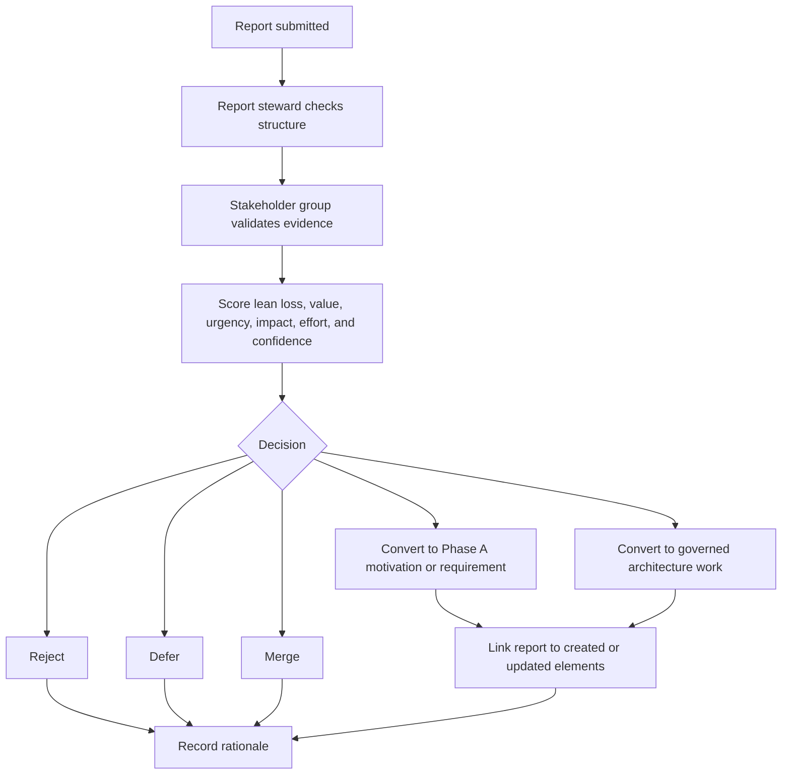

# TOGAF Process

This repository organizes architecture documentation using the TOGAF Architecture Development Method (ADM) as the process frame. The TOGAF repository root is `docs/togaf/`, and this Preliminary phase folder defines the process and modeling rules for the rest of the repository.

This repository is the shared architecture-definition source for related implementation repositories. Submodules and implementation repositories should reference this repository for TOGAF process, repository, governance, and metamodel conventions instead of maintaining a separate TOGAF process definition.

## ADM Phase Flow

This repository uses the TOGAF ADM phase flow to organize architecture work. The ADM is iterative. Requirements Management remains active across all phases, and architecture change feedback can cause earlier phases to be revisited when new evidence changes the architecture motivation, target state, or roadmap.

## Phase Directories

ADM phase documentation is stored under directories named:

```text
docs/togaf/<phase-prefix> - <Phase Name>/
```

Current phase folders:

| Phase | Folder | Repository meaning |
| --- | --- | --- |
| 0 | `docs/togaf/0 - Preliminary/` | Establish architecture capability, repository conventions, principles, governance approach, stakeholder participation, and modeling method. |
| RM | `docs/togaf/RM - Requirements Management/` | Maintain requirements continuously and trace them to stakeholders, reports, motivation elements, architecture decisions, and implementation evidence. |
| A | `docs/togaf/A - Architecture Vision/` | Define stakeholders, concerns, drivers, assessments, goals, outcomes, principles, constraints, and high-level requirements. |
| B | `docs/togaf/B - Business Architecture/` | Describe business capabilities, roles, processes, value streams, and operating model implications. |
| C | `docs/togaf/C - Information Systems Architecture/` | Describe data architecture and application architecture needed to support the business architecture. |
| D | `docs/togaf/D - Technology Architecture/` | Describe platforms, infrastructure, runtime architecture, technology services, and technology standards. |
| E | `docs/togaf/E - Opportunities and Solutions/` | Group solution options, transition architectures, work packages, and candidate implementation approaches. |
| F | `docs/togaf/F - Migration Planning/` | Sequence roadmap increments, release plans, migration paths, dependencies, and value delivery. |
| G | `docs/togaf/G - Implementation Governance/` | Govern implementation against architecture intent, principles, requirements, and approved decisions. |
| H | `docs/togaf/H - Architecture Change Management/` | Capture feedback, ideas, risks, problems, user or tenant signals, and improvement opportunities. |

## Repository Rules

- Use `docs/togaf/0 - Preliminary/` for architecture method, repository, governance, and modeling conventions.
- Use `docs/togaf/RM - Requirements Management/` for requirements and traceability across ADM phases.
- Use `docs/togaf/A - Architecture Vision/` for high-level vision, motivation, scope, capability, stakeholder, and first-cut solution views.
- Use `docs/togaf/B - Business Architecture/` for business roles, services, processes, and business objects.
- Use `docs/togaf/C - Information Systems Architecture/` for application and data architecture.
- Use `docs/togaf/D - Technology Architecture/` for technology architecture.
- Use `docs/togaf/E - Opportunities and Solutions/` for implementation and migration elements such as work packages and plateaus.
- Use `docs/togaf/F - Migration Planning/` for migration sequencing, transition planning, and implementation roadmaps.
- Use `docs/togaf/G - Implementation Governance/` for implementation governance, conformance, and governed delivery evidence.
- Use `docs/togaf/H - Architecture Change Management/` for change drivers, change assessments, and managed architecture evolution.
- Keep process and metamodel documents under `docs/togaf/0 - Preliminary/`.
- Use one standalone markdown article per ArchiMate element.
- Put links to related elements inside each element article.
- Keep the markdown article as the source of truth for the element description until a dedicated modeling tool is introduced.
- Follow the placement rules in [Metamodel](Metamodel.md).

## Motivation-First Flow

Start architecture work with the ArchiMate motivation layer. Before describing target solution structure in detail, the repository needs a shared view of why change is needed, who is affected, what outcomes are desired, and which requirements should guide later architecture work.

The initial scope covers:

- Preliminary Phase assumptions, principles, repository conventions, and method choices.
- Phase H feedback and architecture change inputs.
- Phase A stakeholders, drivers, assessments, goals, outcomes, principles, constraints, and requirements.
- Requirements that are directly traceable to feedback, SWOT analysis, and motivation elements.

Raw feedback and source context must be preserved before interpretation. Feedback should not be prematurely normalized. Each feedback record should preserve the original statement text and add structured metadata:

- Stakeholder or stakeholder group.
- Categories and tags.
- Source context, where known.
- TOGAF relevance, especially the flow from Phase H architecture change management into Phase A architecture vision.
- Related SWOT observations.
- Candidate drivers, assessments, goals, outcomes, constraints, principles, and requirements.

## Report Classification

Architecture-relevant reports must make the lean loss of ignored signals explicit. Reports should not only describe what someone wants or fears; they should also make explicit what the organization loses if the signal is ignored.

Every architecture-relevant report must identify one or more lean loss types and score its market, operational, and technology impact. These metrics support report classification, board routing, and ADM placement. Classification and scoring are evidence for judgment; they do not replace board judgment.

### Lean Loss Types

| Lean loss | Meaning | Typical report signal |
| --- | --- | --- |
| `LL-001 Waiting` | Decisions, clarification, ownership, environment, approval, or architecture guidance arrive too late. | Usually a problem when already observed; a risk when likely to happen; an idea when a possible improvement could reduce waiting. |
| `LL-002 Rework` | Work must be repeated because direction, design, quality, or requirements were wrong or incomplete. | Usually a problem when recurring; a risk when likely; an idea when reuse or standardization could remove rework. |
| `LL-003 Handoff Loss` | Context is lost between roles, functions, delivery, engineering, support, users, or architecture. | Usually a problem when ownership is unclear; a risk when future handoffs will increase; an idea when collaboration tooling or process could reduce the loss. |
| `LL-004 Defect And Quality Loss` | Bugs, fragile design, security exposure, weak tests, poor maintainability, or operational incidents create cost. | Usually a problem when visible; a risk when exposure is probable; an idea when a preventive quality mechanism is proposed. |
| `LL-005 Overproduction` | Teams create features, documents, customizations, or solution options before validated demand or architecture fit exists. | Usually a risk or problem; sometimes an idea when a validation mechanism could prevent premature work. |
| `LL-006 Overprocessing` | Extra approvals, manual coordination, custom report work, documentation, or technical ceremony add effort without proportional value. | Usually a problem when current process is heavy; an idea when automation or simplification could remove it. |
| `LL-007 Inventory And Backlog Aging` | Reports, decisions, requirements, defects, or work wait long enough to become stale. | Usually a problem when backlog age is visible; a risk when unresolved work is accumulating. |
| `LL-008 Underused Knowledge` | Field evidence, user feedback, senior engineering insight, analyst knowledge, or AI-assisted analysis is not used. | Usually an idea when participation could improve learning; a problem when the organization repeatedly ignores available evidence. |
| `LL-009 Market Opportunity Loss` | Revenue, positioning, adoption, credibility, or timing advantage is lost because learning or response is too slow. | Usually a risk when future loss is probable; an idea when a direction could capture the opportunity. |
| `LL-010 Governance Loss` | Decisions, exceptions, requirements, or architecture changes cannot be traced, reviewed, or audited. | Usually a risk or problem; an idea when governance automation or repository participation could reduce the loss. |

### Concern Impact Metrics

Every report must score market, operational, and technology impact using a simple scale from `1` to `5`, where `1` is low impact and `5` is high impact.

| Metric | Scored question | Primary board when dominant |
| --- | --- | --- |
| Market impact | How strongly does the report affect sales, commercial interest, high-level scope negotiation, due diligence, pricing, positioning, packaging, market opportunity, or credibility? | `BOARD-001 Market Board` |
| Operational impact | How strongly does the report affect delivery comfort, ownership, commitment reliability, requirements clarification, planning, coordination, rollout, QA evidence, or operational burden? | `BOARD-002 Delivery Board` |
| Technology impact | How strongly does the report affect architecture, engineering quality, technical feasibility, implementation impact, automation, platform behavior, maintainability, security exposure, DevOps, or technology risk? | `BOARD-003 Architecture Board` |

The highest score usually determines the primary synchronization board. If two or more metrics are high, the report must still name one primary board and list the other affected board or boards as secondary participants.

| Report class | Use when | Primary ADM entry point | Repository location | Typical Phase A conversion |
| --- | --- | --- | --- | --- |
| Idea | The report proposes a possible architecture, process, automation, market, or operating model improvement that still needs validation before it becomes a defined change. | Phase H as an idea or architecture change opportunity, then Phase A if it changes motivation. | `docs/togaf/H - Architecture Change Management/ideas/` | Goal, outcome, principle, requirement, vision input, formal architecture change request, or candidate work package for later Phase E. |
| Risk | The report describes uncertainty that may harm quality, delivery, compliance, cost, user or commercial interest, security, maintainability, governance, or market fit. | Phase H as change-management feedback, then Phase A as an assessment or constraint when material. | `docs/togaf/H - Architecture Change Management/feedback/` | Assessment, constraint, principle, outcome, requirement, or mitigation decision. |
| Problem | The report describes an observed pain, defect, recurring failure, user issue, process bottleneck, current-state limitation, or waste already being experienced. | Phase H as current-state feedback, then Phase A as a driver, assessment, or requirement when architectural. | `docs/togaf/H - Architecture Change Management/feedback/` | Driver, assessment, outcome, requirement, or formal architecture change request. |

### ADM Placement Rules

- Put raw reports in Phase H first so the original signal remains auditable.
- Move only interpreted architecture implications into Phase A motivation and requirements.
- Use Phase B, C, or D only when a validated report requires business, application, data, or technology architecture detail.
- Use Phase E and F when a validated report requires solution grouping, roadmap sequencing, migration planning, or implementation increments.
- Use Phase G when the report concerns implementation conformance, governance exceptions, delivery evidence, or realization of an approved architecture decision.
- Keep Requirements Management linked to every report class once a report produces or changes a requirement.

## Report Validation

Architecture-relevant reports must be validated and scored by a stakeholder group before they are converted into Phase A motivation elements, requirements, or governed work. The validation group does not need to be large for every report, but each report must have named accountable roles for origin, stewardship, architecture judgment, market value, delivery impact, engineering impact, governance quality, and board sponsorship when the report is synchronized.

One person or organization unit may fulfill several validation roles for a simple report, but the report must still show which responsibilities were covered.

| Role | Responsibility in validation and scoring |
| --- | --- |
| `ROLE-001 Report Originator` | Provides the original statement, source context, evidence, and expected value or pain. |
| `ROLE-002 Report Steward` | Structures the report, preserves the original statement, checks required metadata, and prepares it for review. |
| `ROLE-003 Architecture Owner` | Determines whether the report changes drivers, assessments, goals, outcomes, principles, constraints, requirements, or architecture decisions. |
| `ROLE-004 Value Owner` | Scores market value, user relevance, direction fit, and opportunity timing. |
| `ROLE-005 Delivery Owner` | Scores delivery effort, rollout impact, implementation dependency, operational burden, and update impact. |
| `ROLE-006 Engineering Owner` | Scores technical feasibility, quality impact, testability, maintainability, security exposure, and technology risk. |
| `ROLE-007 Governance Reviewer` | Checks traceability, decision quality, required approvals, and whether the report can be audited later. |
| `ROLE-008 Board Sponsor` | Owns board-level synchronization, prioritization follow-up, and clarification with the reporter for routed reports. |



Scores should use a simple scale from `1` to `5`, where `1` is low and `5` is high.

| Dimension | Scored question |
| --- | --- |
| Lean loss severity | How much waste, risk exposure, missed learning, or market loss occurs if the report is ignored? |
| Market impact | How strongly does the report affect sales, commercial interest, high-level scope, due diligence, pricing, positioning, packaging, market opportunity, or credibility? |
| Operational impact | How strongly does the report affect delivery comfort, ownership, commitment reliability, requirements clarification, planning, coordination, rollout, QA evidence, or operational burden? |
| Technology impact | How strongly does the report affect architecture, engineering quality, technical feasibility, implementation impact, automation, platform behavior, maintainability, security exposure, DevOps, or technology risk? |
| Evidence strength | How strong and repeatable is the evidence behind the report? |
| Stakeholder breadth | How many relevant stakeholder groups are affected? |
| Urgency | How quickly does the report need a decision before loss increases? |
| Architecture impact | How strongly does the report affect motivation, requirements, principles, constraints, or architecture decisions? |
| Value | How strongly does the report support adoption, market fit, revenue, credibility, or strategic positioning? |
| Delivery and engineering effort | How much delivery, migration, engineering, testing, or governance effort is likely required? |
| Confidence | How confident is the group that the classification, loss type, and ADM placement are correct? |

Each validated report must record participating roles, responsible handling organization unit, validation date, synchronization board and sponsor when board review is required, report classification, impact scores, lean loss types and severity score, ADM placement, scoring summary, decision, rationale, and trace links.

## Report Handling Organization

Report handling distinguishes organization units, synchronization boards, context representatives, and validation roles.

- Organization units are stable homes for people and handling responsibility.
- Synchronization boards are cross-office forums that score, prioritize, and sponsor reports.
- Context representatives carry each office's view for a sales opportunity, delivery, implementation, operation, or user context.
- Validation roles are per-report responsibilities assigned to people or groups for the current report.

| Identifier | Organization unit | Members or represented positions | Primary report-handling responsibility |
| --- | --- | --- | --- |
| `ORG-001` | Market Office | Executive leadership, operations leadership, sales. | Market, sales, due diligence, high-level scope negotiation, positioning, pricing, commercial risk, and market opportunity reports. |
| `ORG-002` | Delivery Office | Delivery leadership, ownership roles, analysts, project managers, QA. | Delivery, requirements clarification, planning, rollout, implementation coordination, QA evidence, and operational commitment reports. |
| `ORG-003` | Technology Office | Technology leadership, architects, team leads, developers, DevOps. | Architecture, engineering quality, implementation feasibility, automation, DevOps, platform, maintainability, security exposure, and technology risk reports. |

Boards are not separate organization units. They are synchronization forums that draw participants from one or more organization units.

| Identifier | Board | Participating organization units | Primary handling scope |
| --- | --- | --- | --- |
| `BOARD-001` | Market Board | `ORG-001 Market Office`, with `ORG-002 Delivery Office` when shaping, clarification, planning, or delivery feasibility input is material. | Reports whose dominant impact is market value, commercial interest, high-level scope, sales fit, due diligence, pricing, positioning, or packaging. |
| `BOARD-002` | Delivery Board | `ORG-002 Delivery Office`, with `ORG-001 Market Office` or `ORG-003 Technology Office` when market or technology input is material. | Reports whose dominant impact is delivery comfort, ownership, commitment reliability, requirements clarification, QA evidence, rollout, or delivery coordination. |
| `BOARD-003` | Architecture Board | `ORG-003 Technology Office`, with `ORG-002 Delivery Office` when requirements, QA, delivery, release, rollout, or customization impact is material. | Reports whose dominant impact is architecture, engineering quality, frontend, backend, customization, DevOps, platform, automation, maintainability, security exposure, or technology risk. |

Context representatives are the default people expected to provide the office perspective for a sales opportunity, implementation, operation, or active delivery context.

| Identifier | Representative role | Represents | Typical report perspective |
| --- | --- | --- | --- |
| `REP-001` | Market Representative | `ORG-001 Market Office` | Commercial interest, high-level scope, buying concerns, due diligence concerns, pricing sensitivity, and sales risk. |
| `REP-002` | Delivery Representative | `ORG-002 Delivery Office` | Delivery commitment, planning, clarification, coordination, rollout, communication, and operational risk. |
| `REP-003` | Technology Representative | `ORG-003 Technology Office` | Technical feasibility, implementation impact, engineering quality, automation, maintainability, and technology risk. |

Each Phase H report must name a responsible handling organization unit and a proposed synchronization board before board review. Reports may involve more than one organization unit, but one unit must be named as the primary handling owner. Secondary units must be listed when their input is required for scoring, clarification, or evidence.

Validation roles should usually be assigned from the organization units as follows:

| Validation role | Usual organization-unit source |
| --- | --- |
| `ROLE-001 Report Originator` | Any organization unit. |
| `ROLE-002 Report Steward` | Usually `ORG-002 Delivery Office`; may be agent-assisted or assigned by the handling organization unit. |
| `ROLE-003 Architecture Owner` | Usually `ORG-003 Technology Office`. |
| `ROLE-004 Value Owner` | Usually `ORG-002 Delivery Office`, with market input from `ORG-001 Market Office`. |
| `ROLE-005 Delivery Owner` | Usually `ORG-002 Delivery Office`. |
| `ROLE-006 Engineering Owner` | Usually `ORG-003 Technology Office`. |
| `ROLE-007 Governance Reviewer` | Usually `ORG-003 Technology Office` or the synchronization board sponsor when a separate governance reviewer is not assigned. |
| `ROLE-008 Board Sponsor` | The sponsor named by the synchronization board responsible for the report. |

## Legacy Documentation Mapping

Architecture decisions, feature descriptions, and test cases are part of the TOGAF architecture process. Do not create separate `docs/adrs`, `docs/features`, or `docs/tests` documents for new work.

Represent those concerns as TOGAF/ArchiMate elements instead:

- ADR decision records become the phase element that owns the decision, usually a Phase A `Principle`, Phase C application or data element, Phase D technology element, Phase E/F work package, or Phase G governance element.
- Feature descriptions become the element that provides or owns the behavior, usually a Phase C `Application Service`, `Application Component`, or `Data Object`; use Requirements Management `Requirement` or `Constraint` elements when backlog-style traceability is the primary concern.
- Test cases become Phase G `Assessment` elements linked to the application, data, technology, requirement, or work package they assess.

When migrating older ADR, feature, or testcase documents, preserve their original text under a `Source records` section inside the target element article and keep `Description`, `Relations`, and `Required by` as the current architectural summary.

## Metamodel Documents

- [Metamodel](Metamodel.md)
- [Metamodel for A](Metamodel%20for%20A.md)
- [Metamodel for B](Metamodel%20for%20B.md)
- [Metamodel for C Application](Metamodel%20for%20C%20Application.md)
- [Metamodel for C Data](Metamodel%20for%20C%20Data.md)
- [Metamodel for D](Metamodel%20for%20D.md)
- [Metamodel for E](Metamodel%20for%20E.md)
- [Metamodel for F](Metamodel%20for%20F.md)
- [Metamodel for G](Metamodel%20for%20G.md)
- [Metamodel for H](Metamodel%20for%20H.md)
- [Metamodel for RM](Metamodel%20for%20RM.md)

## Notation Convention

Element articles use this compact shape:

```text
# Element Name «ArchiMate Type»

## Description

Short description of the element.

## Relations

- Relationship stereotype: linked element.

## Required by

- Linked element that depends on, requires, or consumes this element.
```

The heading uses angle-quote stereotype notation for the ArchiMate element type. This follows the UML/ArchiMate stereotype idea while staying markdown-friendly. The element name should not repeat the type word carried by the stereotype, for example use `# Collaborative Merge «Capability»`, not `# Collaborative Merge Capability «Capability»`. The phase is implied by the canonical folder defined in [Metamodel](Metamodel.md), so element articles do not repeat an `ADM phase` field.

Sources, traces, and evidence are represented as relationships when they matter to the architecture. Do not add a standalone `Source` metadata field.
